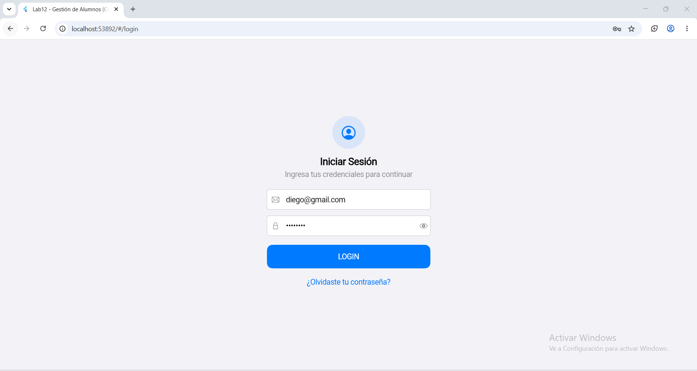
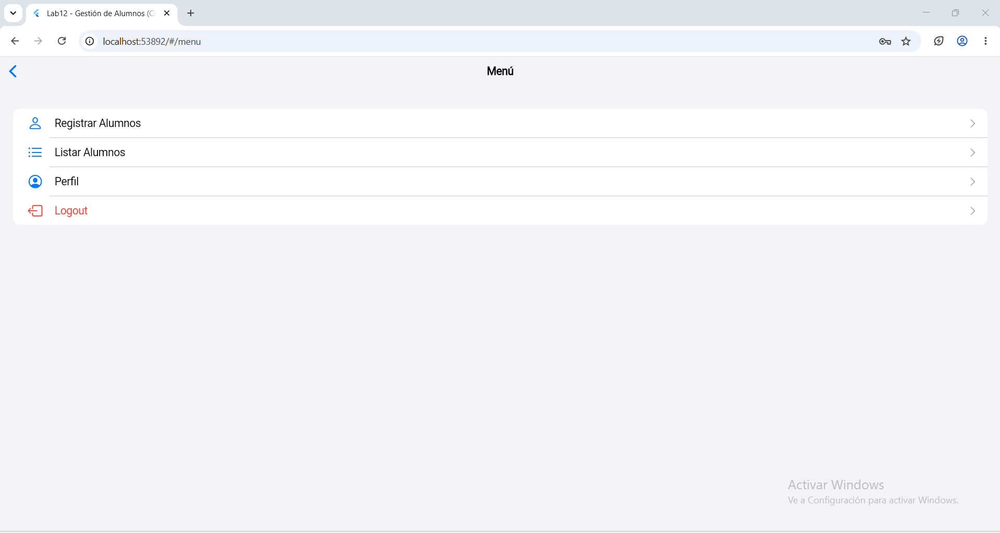
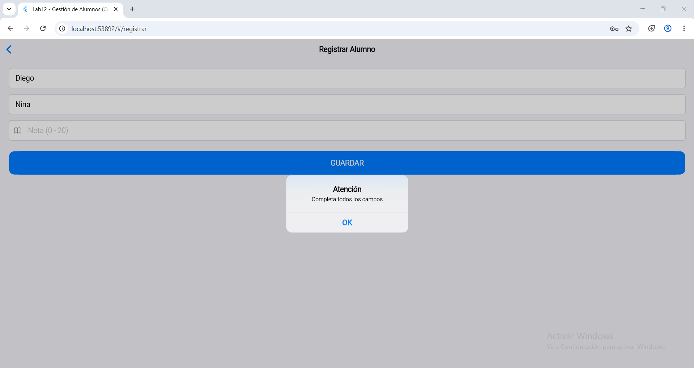
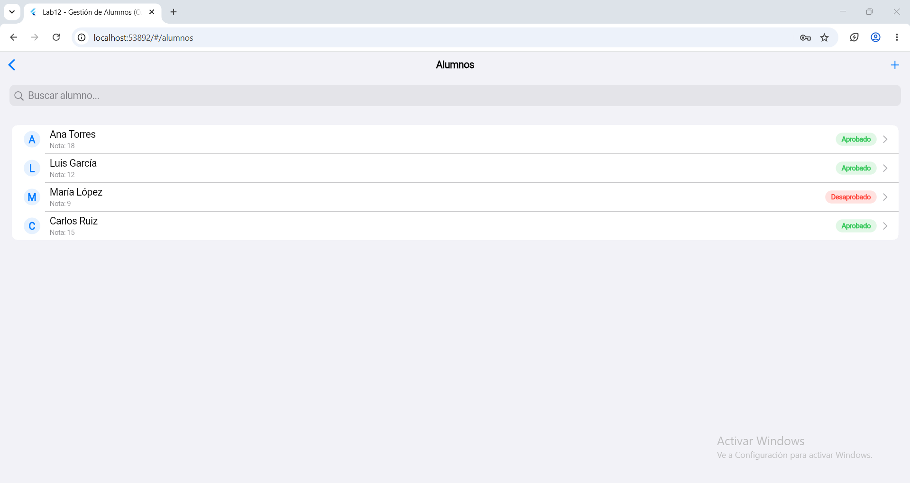
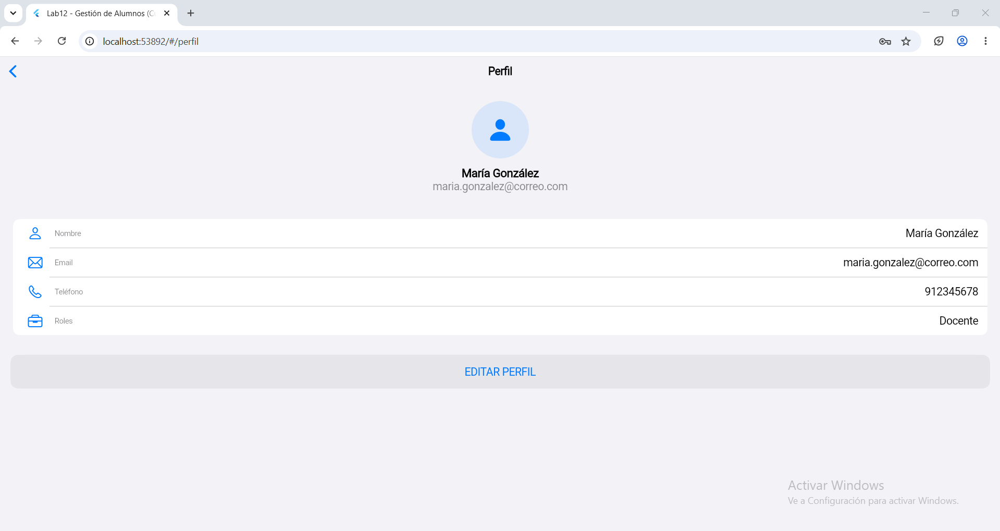
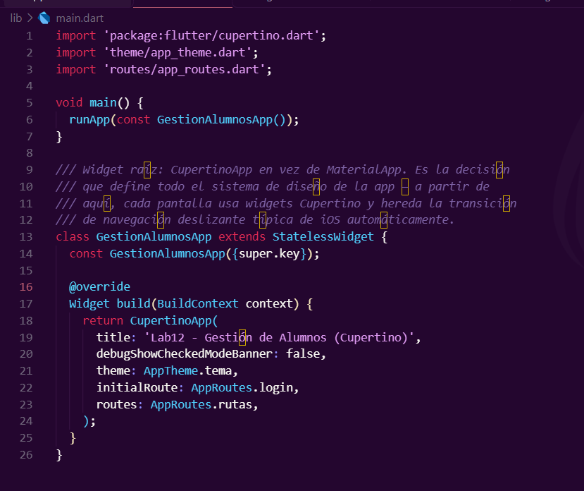
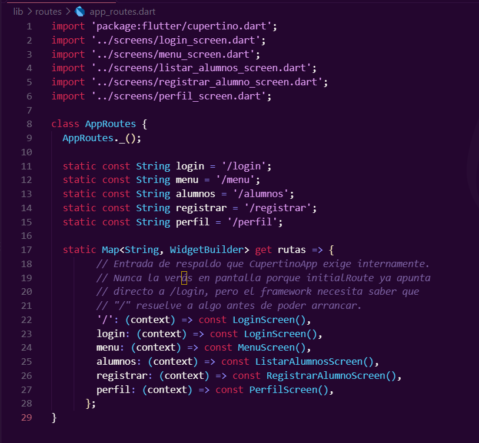
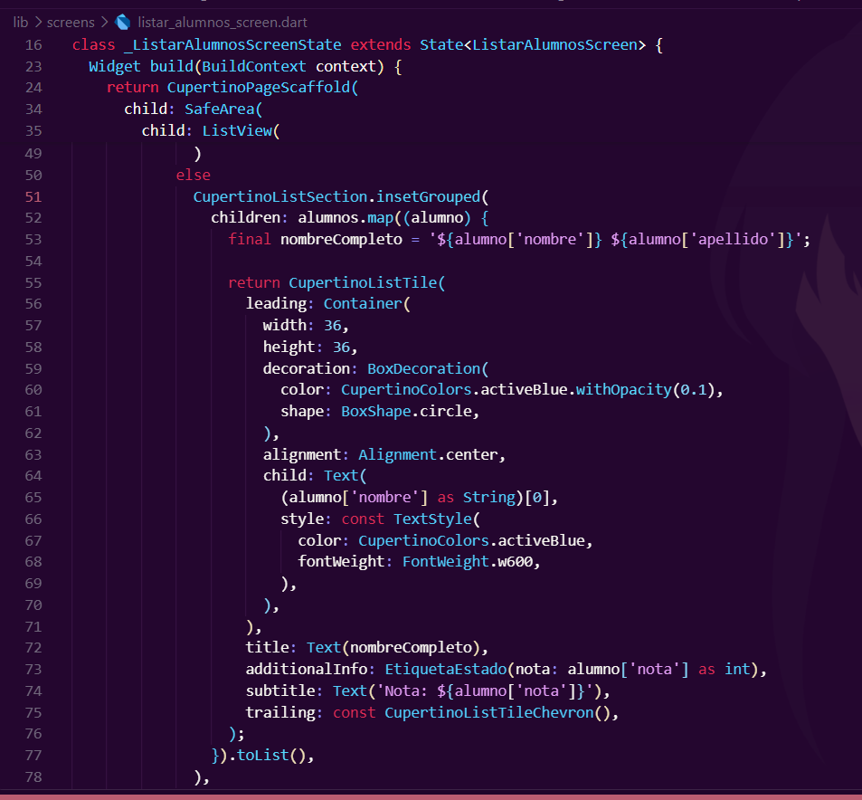
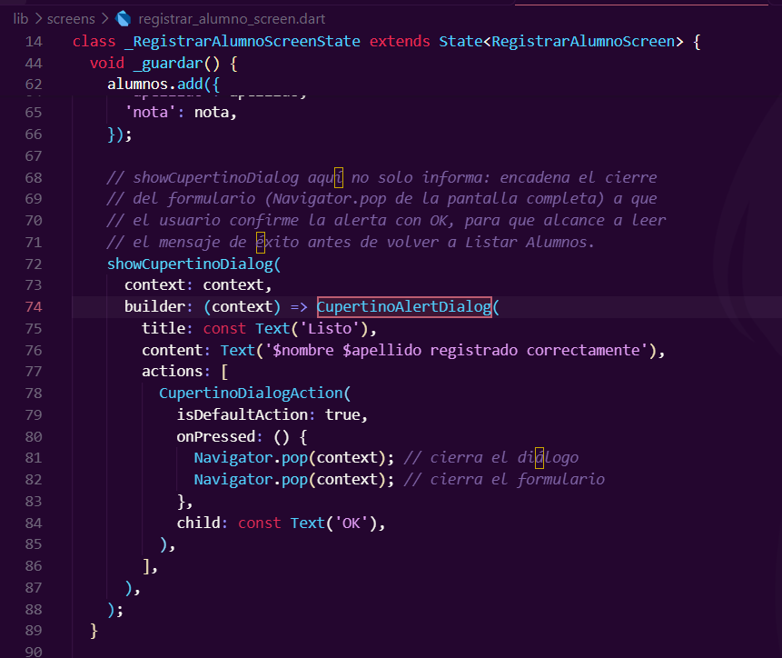
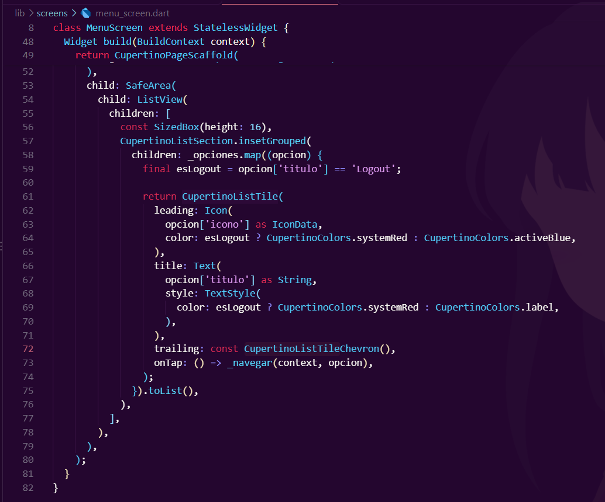

# 📱 Lab12-DAM — Gestión de Alumnos (Cupertino Edition)


-000000?style=for-the-badge&logo=apple&logoColor=white)


> Reconstrucción completa de **Lab08-DAM** reemplazando Material Design por **widgets Cupertino**, manteniendo las mismas 6 capacidades: ListViews, ListTiles, Listas y Mapas, Rutas, Tema Global y Cards (su equivalente iOS).

---

## 📚 Historial de laboratorios

| # | Laboratorio | Tema principal |
|---|---|---|
| 1 | GLAB-S02 | Clases, herencia, constructores con nombre y polimorfismo |
| 2 | GLAB-S03 | Mixins y composición de comportamiento |
| 3 | Calendario Flutter | Diseño de interfaz (widget tree, Material) |
| 4 | Lab08-DAM | App de Gestión de Alumnos con **Material Design** |
| 5 | **Lab12-DAM** | La misma app de Gestión de Alumnos, reconstruida con **Cupertino** |

---

## 🎯 Descripción

Lab12-DAM retoma la app de **Lab08-DAM** y la reconstruye reemplazando por completo el sistema de diseño Material por **Cupertino**, el lenguaje visual de iOS. No se trata de mezclar ambos estilos: cada widget Material tiene su contraparte Cupertino, y el resultado es una app que luce y se comporta como una app nativa de iOS — incluyendo sus transiciones de navegación deslizantes automáticas.

### Capacidades demostradas

| Capacidad | Dónde se aplica |
|---|---|
| **Tema Global** | `CupertinoThemeData` centraliza colores dinámicos del sistema (`CupertinoColors`) |
| **Rutas** | `CupertinoApp` + rutas nombradas, con transición iOS nativa automática |
| **Listas y Mapas** | Datos de alumnos y perfil en `List<Map<String, dynamic>>` |
| **ListViews** | `ListView` + `.map()` para renderizar alumnos y opciones del menú |
| **ListTiles** | `CupertinoListTile` con `leading`, `title`, `subtitle`, `additionalInfo`, `trailing` |
| **Cards (equivalente)** | `CupertinoListSection.insetGrouped` — el agrupador visual iOS que reemplaza a `Card` |

---

## 🖼️ Pantallas de la aplicación

### 1. Login
Pantalla de inicio de sesión con `CupertinoTextField` para email y contraseña (con ícono de ojo para mostrar/ocultar), validación de campos vacíos mediante `CupertinoAlertDialog`, y botón `CupertinoButton.filled` que ocupa el ancho completo gracias a un `SizedBox(width: double.infinity)`.



### 2. Menú
Lista de opciones de navegación (Registrar Alumnos, Listar Alumnos, Perfil, Logout) agrupadas en un `CupertinoListSection.insetGrouped`. El ícono y texto de "Logout" se pintan en `CupertinoColors.systemRed` para diferenciarlo visualmente del resto de acciones.



### 3. Registrar Alumno
Formulario con tres `CupertinoTextField` (nombre, apellido, nota). Al guardar, valida que los campos no estén vacíos y que la nota sea un número entre 0 y 20 usando `int.tryParse`. Si todo es correcto, agrega el alumno a la lista y muestra un `CupertinoAlertDialog` de confirmación antes de volver al menú.



### 4. Listar Alumnos
Lista de alumnos registrados dentro de un `CupertinoListSection.insetGrouped`, cada uno con un avatar circular con su inicial, su nombre completo, la nota y una etiqueta de estado (Aprobado/Desaprobado) construida con `CupertinoColors.systemGreen` / `systemRed`. Incluye un `CupertinoSearchTextField` y un botón `+` en la barra de navegación para registrar un nuevo alumno sin perder el estado de la lista.



### 5. Perfil
Datos del usuario (nombre, email, teléfono, rol) presentados en un `CupertinoListSection.insetGrouped`, con un avatar circular en la cabecera y un botón "Editar Perfil" en gris (`CupertinoColors.systemGrey5`), ya que Cupertino no tiene un estilo nativo de botón "outlined".



---

## 🆕 Código nuevo respecto a laboratorios anteriores

Estas 5 capturas muestran los patrones de Cupertino que **no se habían visto** en labs previos (Material, Node.js, Bizagi, etc.):

### 1. `CupertinoApp` + `CupertinoThemeData`
El widget raíz cambia de `MaterialApp` a `CupertinoApp`. Esta decisión define todo el sistema de diseño de la app: a partir de aquí, cada pantalla usa widgets Cupertino y hereda automáticamente la transición de navegación deslizante típica de iOS.



### 2. Entrada de respaldo para la ruta `/`
`CupertinoApp` (igual que `MaterialApp`) exige internamente que la tabla de rutas resuelva la ruta por defecto `"/"`, incluso cuando se define `initialRoute`. Esta entrada nunca se ve en pantalla —`initialRoute` ya apunta directo a `/login`— pero sin ella la app lanza un `Assertion failed` al arrancar.



### 3. `CupertinoListSection.insetGrouped` + `CupertinoListTile`
El reemplazo directo de `Card` + `ListTile`. Agrupa visualmente los `CupertinoListTile` con el estilo "inset grouped" característico de las apps de Ajustes de iOS, usando `additionalInfo` para mostrar la etiqueta de estado junto al chevron.



### 4. `CupertinoAlertDialog` vía `showCupertinoDialog`
Cupertino no tiene `SnackBar` ni `ScaffoldMessenger`. El reemplazo es `showCupertinoDialog` + `CupertinoAlertDialog`, que al ser una ventana modal bloqueante permite encadenar un doble `Navigator.pop` (cerrar el diálogo y luego el formulario) una vez que el usuario confirma con OK.



### 5. `CupertinoListTile` con colores condicionales
En el menú, cada `CupertinoListTile` cambia de color (ícono y texto) según si la opción es "Logout" o no, usando `CupertinoColors.systemRed` vs. `CupertinoColors.activeBlue`/`label`, y cierra con `CupertinoListTileChevron()` como indicador de navegación.



---

## 🔄 Material → Cupertino: equivalencias aplicadas

| Material (Lab08-DAM) | Cupertino (Lab12-DAM) |
|---|---|
| `MaterialApp` | `CupertinoApp` |
| `Scaffold` | `CupertinoPageScaffold` |
| `AppBar` | `CupertinoNavigationBar` |
| `TextField` | `CupertinoTextField` |
| `FilledButton` | `CupertinoButton.filled` |
| `TextButton` / `OutlinedButton` | `CupertinoButton` |
| `ListTile` | `CupertinoListTile` |
| `Card` | `CupertinoListSection.insetGrouped` |
| `CircleAvatar` | `Container` + `BoxShape.circle` |
| `SnackBar` / `ScaffoldMessenger` | `showCupertinoDialog` + `CupertinoAlertDialog` |
| `Icons.*` | `CupertinoIcons.*` |

---

## 🛠️ Stack tecnológico

| Herramienta | Versión / Detalle |
|---|---|
| Flutter | 3.35.3 |
| Dart | 3.9.2 |
| UI Framework | Cupertino (flutter/cupertino.dart) |
| Plataforma de prueba | Web (Chrome) |

---

## 📂 Estructura del proyecto

```
lib/
├── main.dart
├── theme/
│   └── app_theme.dart
├── data/
│   └── alumnos_data.dart
├── routes/
│   └── app_routes.dart
├── widgets/
│   └── etiqueta_estado.dart
└── screens/
    ├── login_screen.dart
    ├── menu_screen.dart
    ├── listar_alumnos_screen.dart
    ├── registrar_alumno_screen.dart
    └── perfil_screen.dart
```

---

## ▶️ Cómo ejecutar

```bash
git clone https://github.com/diegoninam-ship-it/Lab12-DAM.git
cd Lab12-DAM
flutter pub get
flutter run -d chrome
```

---

<div align="center">

**Diego Nina Malqui**
Diseño y Desarrollo de Software — Tecsup
Curso: Aplicaciones Móviles Multiplataforma
Sección: [completar]

</div>